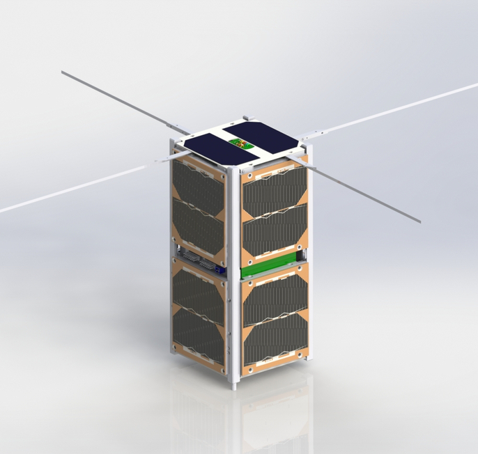

.. introduction.rst

    Copyright The GOLDS-UFSC Contributors.

    GOLDS-UFSC Documentation

    This work is licensed under the Creative Commons Attribution-ShareAlike 4.0
    International License. To view a copy of this license,
    visit http://creativecommons.org/licenses/by-sa/4.0/.

.. _ch:introduction:

************
Introduction
************

GOLDS-UFSC is a 2U CubeSat (10 × 10 × 22.70 cm), and it is a follow up of FloripaSat-1 mission :cite:`floripasat`. Both FloripaSat-1 and GOLDS-UFSC are developed by SpaceLab/UFSC :cite:`spacelab`. GOLDS-UFSC main payload is the EDC board (*Environmental Data Collection*) :cite:`edc`, developed by INPE (Instituto Nacional de Pesquisas Espaciais). The mission is part of the “GOLDS” constellation (“Global Open Collecting Data System”), a collaborative CubeSat constellation for environmental data collection planned as part of the Brazilian Space Program :cite:`golds`.

The project started just after the launch of FloripaSat-1 (first half of 2020) and is planned to be launched in 2023. Most of the embedded electronics is partially or totally based on the FloripaSat-1 satellite, with the same and/or improved versions of the modules. In other words, this project has, at some level, a flight heritage.

A conceptual image of the GOLDS-UFSC satellite is shown in :numref:`fig:GOLDS-UFSC-render`.

.. _fig:GOLDS-UFSC-render:

   GOLDS-UFSC 3D renderization.

Mission Description
===================
The mission's main objective is the In-Orbit Validation (IoV) of INPE's EDC payload, using a service module based on FloripaSat-1 bus. The EDC payload is a module developed for CubeSats and capable of receiving data from data collection stations (Plataformas de Coleta de Dados, PCDs) of the Brazilian Data Collection System (*Sistema Brasileiro de Coleta de Dados*, SBCD) installed along the Brazilian territory. The received data is forwarded to the ground segment through the main communication link offered by the satellite service module. A scientific contribution of the mission is the evaluation of radiation effects on electronic devices, as both EDC and the service platform are based on COTS. The radiation effects evaluation will be performed by the Radiation instrument, which has also been developed for the FloripaSat-1 mission. The mission provides also a relay service to the amateur radio community.

Mission Objectives
==================

The main objectives of the mission are as follows:

#. In-Orbit Validation (IoV) of INPE's EDC payload.
#. Provide a flight model for the satellite's service platform, based on FloripaSat-1 bus.
#. Set up the ground segment for the mission operation.
#. Receive environmental data from ground (from EDC stations), and forward the collected data to the ground station.
#. Validate core-satellite functions in orbit.
#. Perform experiments on radiation effects in electronic components in orbit, evaluating the radiation levels affecting EDC and the service platform modules.
#. Serve as a relay for amateur radio communications, contributing to the amateur radio community.

Project Members
===============

All people involved in the project are students, professors and researchers from Federal University of Santa Catarina (UFSC), the National Institute for Space Research (INPE) and the Brazilian Space Agency (AEB (Agência Espacial Brasileira)).

A list with the current members directly related to the project (2022/10/24) can be seen in :numref:`tab:team-members`.

.. _tab:team-members:

.. list-table:: Project members (2022/10/24).
   :header-rows: 1
   :widths: 45 10 30 15

   * - Name
     - Title
     - Position
     - Institution
   * - Anderson Wedderhoff Spengler
     - Dr.
     - Professor
     - UFSC
   * - Eduardo Augusto Bezerra
     - Ph.D.
     - Professor
     - UFSC
   * - Richard Demo Souza
     - Dr.
     - Professor
     - UFSC
   * - Xisto Lucas Travassos
     - Dr.
     - Professor
     - UFSC
   * - Laio Oriel Seman
     - Dr.
     - Researcher
     - UFSC
   * - Rodrigo Leonardi
     - Dr.
     - Researcher
     - AEB
   * - José Marcelo Duarte
     - Dr.
     - Researcher
     - INPE
   * - Manoel Jozeane Mafra de Carvalho
     - M.Sc.
     - Researcher
     - INPE
   * - Gabriel Mariano Marcelino
     - M.Sc.
     - Doctoral Student
     - UFSC
   * - Brenda Fernandes Ribeiro
     - M.Sc.
     - Doctoral Student
     - UFSC
   * - André Martins Pio de Mattos
     - B.Eng.
     - Doctoral Student
     - UFSC
   * - Edilberto Costa Neto
     - B.Eng.
     - Master Student
     - UFSC
   * - Vinicius Pimenta Bernardo
     - B.Eng.
     - Master Student
     - UFSC
   * - Augusto Cezar Boldori Vassoler
     - B.Eng.
     - Master Student
     - UFSC
   * - Bruno Benedetti
     - -
     - Undergraduate Student
     - UFSC
   * - Caique Sales Miranda Gomes
     - -
     - Undergraduate Student
     - UFSC
   * - João Cláudio Elsen Barcellos
     - -
     - Undergraduate Student
     - UFSC
   * - Lucas Zacchi
     - -
     - Undergraduate Student
     - UFSC
   * - Matheus Wagner
     - -
     - Undergraduate Student
     - UFSC
   * - Miguel Böing
     - -
     - Undergraduate Student
     - UFSC
   * - Ramon de Araújo Borba
     - -
     - Undergraduate Student
     - UFSC
   * - Rebecca Quintino do O
     - -
     - Undergraduate Student
     - UFSC
   * - Vitória Beatriz Bianchin
     - -
     - Undergraduate Student
     - UFSC

All the modules and methods used in this project are based in past works, mainly the FloripaSat-1 and the EDC projects. The list with the indirectly involved people is much bigger.

Mission Patch
=============

The mission patch of the GOLDS-UFSC can be seen in :numref:`fig:mission-patch`; it is inspired by the FloripaSat-1 patch :cite:`floripasat` as it uses the flight heritage from its core modules (EPS, OBDH, TTC), which have been improved at hardware and/or software levels, to achieve the new requirements. The patch shows Brazil, the country of the mission's origin, gray orbits representing a constellation of CubeSats, and the yellow circles representing the "gold" color as a reference to the GOLDS constellation.

.. _fig:mission-patch:

.. figure:: figures/golds-ufsc-patch.png
   :width: 45%
   :align: center
   :alt: GOLDS-UFSC mission patch.

   GOLDS-UFSC mission patch.
